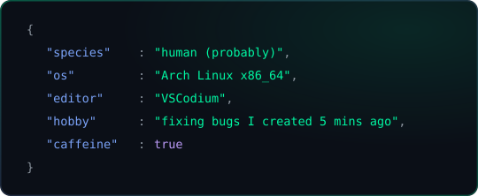

<!--
  Credit: XLliyy
-->

<!-- BANNER -->

  

<!-- GREETING -->

  

<!-- TYPING SVG -->

  

<!-- ABOUT ME -->

  

<!-- SOCIAL ICONS -->

  <!--  -->
  

---

<!-- SKILLS -->

  

  <!-- Languages & Frameworks -->
  
   
  <!-- Tools & Editors -->
  
   
  <!-- OS -->
  

---

<!-- GITHUB STATS -->
<h3 align="center">Statistics</h3>

  <table border="0" cellpadding="0" cellspacing="0">
    <tr>
      <td align="center" valign="top">
        
      </td>
      <td align="center" valign="top">
        
      </td>
    </tr>
    <tr>
      <td colspan="2" align="center" valign="top">
        
      </td>
    </tr>
  </table>

---

<!-- SNAKE -->
<h3 align="center"><code>&gt;_ Hey there! I'm using Arch</code></h3>

<i>(and watching a snake eat my green squares)</i>

  

<!-- FOOTER -->

  

